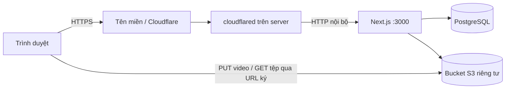

# Triển khai LMS qua tên miền công khai

Repo có sẵn [Dockerfile](../Dockerfile), [Compose production](../compose.production.yml) và [mẫu môi trường](../.env.production.example). Ứng dụng đã được build và chạy thử bằng Docker trên server đích với PostgreSQL riêng; kết quả kiểm thử chi tiết ở [CODE_REVIEW.md](CODE_REVIEW.md). Tên miền HTTPS và bucket vận hành thật cần được cấu hình cho môi trường sử dụng.

## Kiến trúc



Compose production dùng project `lms-dtq` để tách khỏi stack phát triển. PostgreSQL chỉ ở trong network Docker; cổng ứng dụng được map ra `127.0.0.1`, mặc định cổng 3000, để nối với tunnel hoặc reverse proxy trên host. Không cần chiếm cổng 80/443 của dịch vụ hiện hữu.

Dockerfile dùng Node.js 22/Debian có OpenSSL, build trong môi trường Linux và chạy ứng dụng bằng user `node` không phải root. Image giữ Prisma CLI và `tsx` để thực hiện migration/cấp tài khoản bằng container. Server không cần cài Node.js/npm trực tiếp.

## Chuẩn bị cấu hình

Yêu cầu Git, Docker và Docker Compose v2. Lấy mã nguồn:

```bash
git clone https://github.com/Bluenip/LMS-FOR-DTQ.git
cd LMS-FOR-DTQ
cp .env.production.example .env.production
```

Điền ít nhất ba giá trị trong `.env.production`:

```dotenv
POSTGRES_PASSWORD=<mat-khau-PostgreSQL-rieng-dang-hex>
SESSION_SECRET=<chuoi-ngau-nhien-rieng-it-nhat-32-ky-tu>
APP_URL=https://lms.example.com
LMS_PORT=3000
LMS_IMAGE=lms-dtq:local
```

Có thể sinh hai chuỗi bằng Python trên Ubuntu:

```bash
python3 -c "import secrets; print(secrets.token_hex(24))"
python3 -c "import secrets; print(secrets.token_hex(48))"
```

Dùng chuỗi đầu cho `POSTGRES_PASSWORD`, chuỗi sau cho `SESSION_SECRET`. Mật khẩu PostgreSQL dạng hex tránh ký tự cần encode khi Compose tạo `DATABASE_URL`. App kết nối database qua tên service `postgres:5432`; không dùng `localhost` trong URL kết nối giữa hai container.

`APP_URL` phải khớp origin người dùng truy cập: đúng HTTPS, hostname và cổng nếu có; không thêm đường dẫn hoặc dấu `/` cuối. Biến này được dùng để kiểm tra nguồn yêu cầu ghi dữ liệu. Cookie phiên bật Secure trong production nên cần kiểm thử đăng nhập qua HTTPS thật trước khi sử dụng.

`.env.production` được Git và Docker build context loại trừ. Các khóa được cấp vào container lúc chạy; không nằm trong image build. Production Compose luôn đặt `ALLOW_DEMO_ACCOUNTS=false`.

## Build, migration và khởi động

```bash
docker compose --env-file .env.production -f compose.production.yml build app
docker compose --env-file .env.production -f compose.production.yml up -d --wait
```

Compose chờ PostgreSQL healthy, chạy `prisma migrate deploy` trong service `migrate`, rồi mới khởi động app. Migration lỗi thì app không được khởi động. Không cần chạy seed để khởi tạo hệ thống thật. Cơ chế chờ các dịch vụ dựa trên [điều kiện khởi động của Docker Compose](https://docs.docker.com/compose/how-tos/startup-order/).

```bash
docker compose --env-file .env.production -f compose.production.yml ps
docker compose --env-file .env.production -f compose.production.yml logs --tail 100 app migrate
```

App và PostgreSQL tự chạy lại khi lỗi hoặc khi Docker khởi động lại. Log mỗi container được giới hạn 3 file, mỗi file 10 MB. Healthcheck app kiểm tra API cấu hình có phản hồi HTTP thành công; PostgreSQL có healthcheck riêng. Healthcheck app chưa phải phép thử đầy đủ cho toàn bộ thao tác database và kho tệp.

Không sao chép `node_modules/` hoặc `.next/` từ máy phát triển sang server để thay bước build.

## Cấp quản trị viên đầu tiên

Chạy sau khi migration hoàn tất:

```bash
docker compose --env-file .env.production -f compose.production.yml run --rm migrate npm run account:create-teacher -- owner@example.com "Tên quản trị viên"
docker compose --env-file .env.production -f compose.production.yml run --rm migrate npm run account:grant-admin -- owner@example.com
```

Nếu tài khoản thật đã có sẵn và đang hoạt động, chỉ chạy lệnh cấp quyền quản trị. Mật khẩu mặc định của tài khoản mới là `123@123aA`; đổi tại `/profile` trước khi đưa hệ thống vào sử dụng. Hiện chưa có cơ chế bắt buộc đổi ở lần đăng nhập đầu. Cấp tài khoản giáo viên/học viên còn lại từ `/admin`.

## Tên miền và Cloudflare Tunnel

Địa chỉ Tailscale dùng cho kết nối riêng và quản trị SSH; không đặt địa chỉ đó làm bản ghi A của website công khai. Xem [tài liệu địa chỉ Tailscale](https://tailscale.com/docs/concepts/tailscale-ip-addresses).

Server đã có `cloudflared` hoạt động. Nếu tên miền ở tài khoản Cloudflare phù hợp, thêm một published application route cho hostname LMS mới vào tunnel hiện có. Ví dụ:

| Trường            | Giá trị mẫu               |
| ----------------- | ------------------------- |
| Hostname          | `lms.example.com`         |
| Service URL       | `http://127.0.0.1:3000`   |
| `APP_URL` của app | `https://lms.example.com` |

Một tunnel có thể phục vụ nhiều hostname; chỉ thêm route mới, giữ các route hiện hữu. Không cài đè dịch vụ `cloudflared` để thêm một ứng dụng. Xem [Cloudflare: Published applications](https://developers.cloudflare.com/cloudflare-one/networks/connectors/cloudflare-tunnel/routing-to-tunnel/) và [xử lý dịch vụ đã được cài](https://developers.cloudflare.com/cloudflare-one/troubleshooting/tunnel/).

Ví dụ này giả định connector chạy trên host cùng máy với app. Nếu connector ở container riêng, `127.0.0.1` là chính container đó; cần network dùng chung và service URL trỏ tới tên service ứng dụng.

Giữ origin công khai khi chuyển request qua proxy, truyền IP client qua chuỗi proxy đáng tin cậy và tránh đặt quy tắc cache công khai cho dữ liệu người dùng hoặc `/api/*`.

## Kho tệp và video

Điền các biến `S3_*` trong `.env.production` khi cần tải tệp. Với AWS S3 có thể để endpoint trống và đặt region thực; với R2 dùng endpoint tài khoản và region `auto`.

Bucket phải riêng tư. Server cần truy cập được bucket; URL ký trả cho trình duyệt cũng phải truy cập được từ Internet. Hostname container như `storage:9000` chỉ dùng được trong kiểm thử nội bộ, không phù hợp với trình duyệt của học viên ngoài server.

Áp dụng CORS cho origin HTTPS thật theo [prisma/s3-cors.json](../prisma/s3-cors.json). Kiểm tra PUT video trực tiếp, GET/HEAD/Range và CopyObject theo các thao tác SDK đang sử dụng. Giới hạn ứng dụng là 25 MiB cho tài liệu và 2 GiB cho video. Tệp tài liệu đi qua API; video đi trực tiếp tới bucket.

Kho S3 giả lập trong `docker-compose.yml` chỉ phục vụ phát triển/kiểm thử, không nằm trong Compose production. Xóa lớp hiện chưa tự xóa object trong bucket; cần tính việc dọn tệp không còn sử dụng vào kế hoạch vận hành.

## Backup và nâng cấp

Database nằm trong volume `lms-dtq_postgres_data`. Không dùng thao tác xóa volume để cập nhật ứng dụng. Lưu backup ngoài volume của database và kiểm tra khôi phục trên database thử.

Ví dụ tạo bản sao PostgreSQL từ thư mục dự án:

```bash
mkdir -p backups
docker compose --env-file .env.production -f compose.production.yml exec -T postgres pg_dump -U lms -d lms -Fc > backups/lms.dump
```

Lệnh ghi vào `backups/lms.dump`; dùng tên mới cho mỗi lần sao lưu để giữ lịch sử. Tệp backup chứa dữ liệu người dùng, không commit vào Git.

Khi nâng cấp mã nguồn, tạo backup trước rồi chạy lại `build app` và `up -d --wait`. Giữ image/bản mã nguồn trước đó và kế hoạch khôi phục database phù hợp migration. Ứng dụng chưa có lệnh tự chuyển `.data/demo.json` sang PostgreSQL.

## Kiểm tra trước khi sử dụng

1. Xác nhận app và PostgreSQL healthy, migration hoàn tất; tiến trình còn chạy sau khi đóng SSH và sau reboot.
2. Qua hostname HTTPS thật, đăng nhập quản trị, đổi mật khẩu và tạo tài khoản thử riêng.
3. Dùng hai phiên giáo viên/học viên: tạo lớp, duyệt học viên, xuất bản bài giảng, nộp bài, thu hồi trước hạn và trả điểm.
4. Xác nhận bản nháp/tệp nháp và điểm chưa trả không lộ qua API hoặc tải xuống.
5. Tải tài liệu/video thật từ mạng ngoài server; kiểm tra dữ liệu sau restart và thử khôi phục backup.
6. Đo CPU, RAM, độ trễ API và transaction với số phiên mục tiêu trước khi cam kết quy mô sử dụng.

Lượt kiểm thử nội bộ chưa thay thế kiểm thử HTTPS, CORS/IAM của bucket thật hoặc đo tải đồng thời. Giới hạn còn lại được ghi tại [CODE_REVIEW.md](CODE_REVIEW.md).
