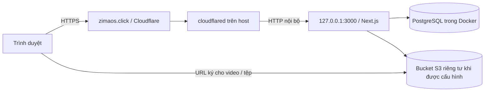

# Triển khai LMS qua tên miền công khai

Dùng [Dockerfile](../Dockerfile), [Compose production](../compose.production.yml) và [script cập nhật](../scripts/auto-deploy.sh) trên Linux có Git, Bash, Docker, Compose v2, `flock`, `timeout` và systemd. Host không cần cài Node.js/npm.

## Kiến trúc và cổng



Project Compose là `lms-dtq`. PostgreSQL dùng volume `lms-dtq_postgres_data`, không mở cổng ra host. App map cổng `127.0.0.1:3000`; tunnel chạy trên cùng host trỏ tới `http://127.0.0.1:3000`. Nếu connector chạy trong container khác, phải dùng network/service thích hợp thay vì loopback của host.

Dockerfile build trên Node.js 22/Debian có OpenSSL, chạy bằng user `node` và giữ Prisma CLI/`tsx` để migration/cấp tài khoản. App/PostgreSQL có `restart: unless-stopped`; Docker phải được bật cùng hệ thống. Healthcheck `/api/health` thực hiện truy vấn PostgreSQL và kiểm tra cấu hình phiên/origin; không kiểm tra kho S3.

## Lấy mã và cấu hình

Ví dụ thư mục trên server:

```bash
mkdir -p ~/apps
git clone https://github.com/Bluenip/LMS-FOR-DTQ.git ~/apps/lms-dtq
cd ~/apps/lms-dtq
cp .env.production.example .env.production
chmod 600 .env.production
```

Điền các giá trị trong `.env.production`:

```dotenv
POSTGRES_PASSWORD=<mat-khau-rieng-dang-hex>
SESSION_SECRET=<khoa-rieng-it-nhat-32-ky-tu>
APP_URL=https://zimaos.click
LMS_PORT=3000
LMS_IMAGE=lms-dtq:local
TRUST_PROXY_HEADERS=true
```

Sinh hai chuỗi riêng bằng `python3 -c "import secrets; print(secrets.token_hex(48))"`. Dùng mật khẩu PostgreSQL dạng hex để an toàn khi ghép vào URL kết nối. `APP_URL` phải đúng origin HTTPS, không thêm đường dẫn/dấu `/` cuối. Khóa được truyền lúc chạy, không đóng gói vào image; Git và Docker bỏ qua `.env.production` và `.deploy/`. Production luôn tắt đăng nhập tài khoản demo.

Chỉ bật `TRUST_PROXY_HEADERS=true` khi app chỉ nhận kết nối từ proxy đáng tin cậy, như tunnel trên host và cổng app chỉ mở loopback. Khi bật, app ưu tiên `CF-Connecting-IP`, nếu không có thì lấy IP cuối của `X-Forwarded-For`; khi tắt, app bỏ qua các header này.

## Triển khai lần đầu và tự cập nhật

```bash
cd ~/apps/lms-dtq
bash scripts/auto-deploy.sh --once
bash scripts/auto-deploy.sh --install-systemd
```

Lệnh thứ nhất fetch `origin/main`, chỉ fast-forward, build image `lms-dtq:<12 ký tự commit>`, sao lưu PostgreSQL bằng `pg_dump`, chạy migration rồi chờ app healthy. Build diễn ra khi app cũ vẫn chạy; lúc thay container có thể có gián đoạn ngắn. Không seed dữ liệu demo vào hệ thống thật.

Lệnh thứ hai cài user service/timer `lms-dtq-update` và bật user lingering. Timer chạy sau khi user manager khởi động khoảng 45 giây và khoảng 60–70 giây sau lần kiểm tra trước. Lingering giúp timer khởi động khi server bật/reboot mà không cần đăng nhập SSH. Nếu hệ thống từ chối bật lingering, quản trị server cần cấp quyền cho thao tác đó; kiểm tra kết quả trước khi coi việc tự khởi động là hoàn tất.

```bash
loginctl show-user "$USER" -p Linger
systemctl --user is-enabled lms-dtq-update.timer
systemctl --user list-timers lms-dtq-update.timer
journalctl --user -u lms-dtq-update.service -n 80 --no-pager
```

Script dùng khóa `flock` để tránh hai lần deploy chồng nhau và bản sao riêng của script để tự cập nhật an toàn. Không có commit mới thì không build lại. Repo có chỉnh sửa cục bộ hoặc lịch sử phân nhánh thì dừng, không reset dữ liệu. Sau lỗi, script chờ khoảng 5 phút trước khi thử lại cùng commit. Chỉ thay các file đã được Git theo dõi; cấu hình thật, database, backup và credential không bị checkout ghi đè.

Lệnh vận hành:

```bash
# Kiểm tra/cập nhật ngay; --force cũng áp dụng thay đổi .env.production khi không có commit mới.
bash scripts/auto-deploy.sh --once
bash scripts/auto-deploy.sh --force

# Dừng kiểm tra GitHub, ứng dụng vẫn chạy.
systemctl --user disable --now lms-dtq-update.timer
```

Commit/image triển khai thành công được ghi tại `.deploy/active`. Script giữ ba bản backup trước deploy gần nhất, giữ image đang chạy và image trước đó. Nếu rollout lỗi, script thử khôi phục image app trước; **không tự hạ migration hay khôi phục database**. Migration cần tương thích với phiên bản trước; thay đổi schema không tương thích cần kế hoạch bảo trì/khôi phục riêng. GitHub mất kết nối hoặc build lỗi không chủ động dừng app đang chạy.

## Chạy lệnh Compose với đúng image hiện hành

Auto updater truyền tag image riêng khi chạy Compose. Trước các lệnh quản trị thủ công, nạp tag thành công từ `.deploy/active` để không vô tình chạy lại image cũ trong `.env.production`:

```bash
cd ~/apps/lms-dtq
read -r deployed_commit LMS_IMAGE < .deploy/active
export LMS_IMAGE

docker compose --env-file .env.production -f compose.production.yml ps
docker compose --env-file .env.production -f compose.production.yml logs --tail 80 app migrate
curl --fail http://127.0.0.1:3000/api/health
```

Không dùng `down -v` khi nâng cấp; lệnh đó xóa dữ liệu PostgreSQL.

## Cấp quản trị viên đầu tiên

Chạy sau deploy, với tag image hiện hành đã nạp như trên. Đặt mật khẩu riêng qua biến môi trường để không đưa mật khẩu vào lịch sử câu lệnh hoặc tham số tiến trình:

```bash
read -rsp 'Mật khẩu quản trị mới: ' ACCOUNT_INITIAL_PASSWORD
printf '\n'
export ACCOUNT_INITIAL_PASSWORD
docker compose --env-file .env.production -f compose.production.yml run --rm -T -e ACCOUNT_INITIAL_PASSWORD migrate npm run account:create-teacher -- admin@zimaos.click "Quản trị LMS"
unset ACCOUNT_INITIAL_PASSWORD
docker compose --env-file .env.production -f compose.production.yml run --rm -T migrate npm run account:grant-admin -- admin@zimaos.click
```

CLI từ chối ghi đè tài khoản đã tồn tại. Nếu đã có tài khoản thật đang hoạt động, chỉ cấp quyền quản trị. Khi bỏ trống `ACCOUNT_INITIAL_PASSWORD`, CLI dùng mật khẩu mặc định `123@123aA`; nên đặt mật khẩu riêng cho quản trị ngay từ đầu. Tài khoản tạo/reset từ giao diện vẫn dùng mật khẩu mặc định và hiện chưa bắt buộc đổi ở lần đăng nhập đầu. Người dùng đổi tại `/profile`; cấp các tài khoản còn lại từ `/admin`.

## Cloudflare Tunnel

Dùng hostname `zimaos.click`, service `http://127.0.0.1:3000`, `APP_URL=https://zimaos.click`. DNS proxied phải trỏ tới tunnel đúng tài khoản; không dùng địa chỉ Tailscale làm bản ghi A công khai. Giữ origin công khai khi proxy yêu cầu và không áp dụng cache công khai cho API/dữ liệu người dùng.

Tên miền gốc trước đây phục vụ giao diện AdGuard. Chủ server đã cho phép dùng hostname này cho LMS; chỉ thay route `zimaos.click`. Các route Anki, Home Assistant và dịch vụ AdGuard trên LAN được giữ nguyên. Không cài đè daemon `cloudflared` hiện có để thêm ứng dụng.

## Kho tệp và video

Điền các biến `S3_*` trong `.env.production` rồi chạy updater `--force`. Bucket phải riêng tư; server và trình duyệt phải truy cập được các URL ký. Hostname nội bộ như `storage:9000` chỉ dành cho kiểm thử. Với R2 dùng endpoint tài khoản và region `auto`; AWS S3 dùng region thật và có thể để endpoint trống.

Áp dụng CORS cho origin `https://zimaos.click` theo [prisma/s3-cors.json](../prisma/s3-cors.json). Kiểm tra PUT trực tiếp, GET/HEAD/Range và CopyObject với bucket thật. Tài liệu tối đa 25 MiB đi qua API; video tối đa 2 GiB đi thẳng tới bucket. Kho S3 giả lập trong Compose phát triển không được đưa lên production.

Tài khoản Cloudflare hiện báo R2 chưa bật khi kiểm tra. Khi chưa cấp kho S3/R2, có thể dùng bài giảng YouTube và bài làm viết trực tiếp; **tải tài liệu/video/tệp bài làm chưa sử dụng được**. Không có kho tệp giả lập công khai thay thế cho cấu hình thật.

## Backup và phục hồi

Backup trước deploy nằm tại `.deploy/backups/`, quyền truy cập chỉ dành cho tài khoản triển khai. Ba bản gần nhất nằm trên cùng ổ đĩa server, không thay thế backup định kỳ ra nơi khác. Nếu không có commit mới, updater không tạo backup mới. Tệp backup chứa dữ liệu người dùng, không commit hoặc công khai.

Tạo backup thủ công sau khi nạp image hiện hành:

```bash
mkdir -p .deploy/backups
chmod 700 .deploy/backups
(umask 077; docker compose --env-file .env.production -f compose.production.yml exec -T postgres pg_dump -U lms -d lms -Fc > ".deploy/backups/manual-$(date -u +%Y%m%dT%H%M%S).dump")
```

Khôi phục vào database thử trước khi dùng backup để phục hồi hệ thống thật. Cần dừng timer và app khi phục hồi dữ liệu production, xác định image/schema phù hợp và giữ bản hiện tại để có thể quay lại. Hiện chưa có lệnh tự chuyển JSON demo sang PostgreSQL; xóa lớp cũng chưa tự xóa object trong bucket.

## Xác minh sau triển khai

Kiểm tra HTTPS `/api/health`, đăng nhập quản trị và cookie Secure/HttpOnly, API quản trị, bài giảng/bài tập, timer và chính sách restart. Kiểm thử PostgreSQL/S3 dùng stack riêng theo [INTEGRATION.md](INTEGRATION.md), không trỏ script tích hợp vào dữ liệu thật. Kiểm tra video thật từ mạng ngoài khi có bucket. Chưa có số đo để cam kết số học viên đồng thời; xem [CODE_REVIEW.md](CODE_REVIEW.md).

## Trạng thái triển khai ngày 03/11/2026

Bản production nằm ở `/home/bluenip/apps/lms-dtq`, URL https://zimaos.click, cổng `127.0.0.1:3000`. App/PostgreSQL healthy; migration hoàn tất. Tunnel đã đổi riêng route tên miền gốc theo phép chủ server; các route khác được giữ nguyên.

Timer `lms-dtq-update.timer` enabled và user lingering đã bật. Docker/cloudflared enabled cùng hệ thống, app/PostgreSQL có restart policy. Chưa reboot toàn server trong lượt này vì còn các dịch vụ khác đang chạy.

Quản trị đầu tiên là `admin@zimaos.click`. Mật khẩu ngẫu nhiên ban đầu chỉ nằm tại `/home/bluenip/apps/lms-dtq/.deploy/admin-credentials.json` trên server (quyền 600); đọc qua SSH rồi đổi tại `/profile`. File này không tự cập nhật khi đổi mật khẩu, có thể xóa sau khi bàn giao an toàn. Không đưa file lên GitHub.

Đã xác minh đăng nhập bằng mật khẩu riêng, cookie Secure/HttpOnly, trang/API quản trị và healthcheck qua HTTPS thật. Production chỉ có quản trị thật, không seed demo. Kho tệp vận hành chưa được cấp; cần bật/cấu hình R2 hoặc S3 trước khi dùng tính năng tải tệp.
